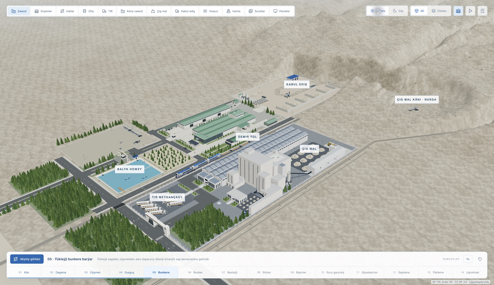
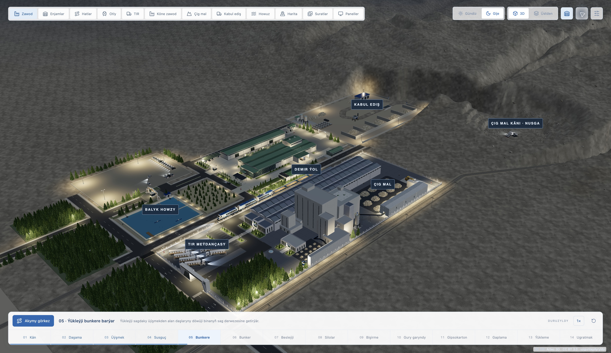

# Ak Bulut — Dostluk önümçilik merkezi

Türkmençe, büyük ekran için React + Three.js sunum demosu. Arayüz ve yeni ekipmanlar beyaz/mavi; mevcut tesisin yeşil çatıları referansa uygun korunur.

## Açık ve koyu görünüm

3D tesisin **Gündiz** (açık) ve **Gije** (koyu) aydınlatması. Sağ üstteki düğmelerle sahneler arasında geçiş yapılır. Ekran görüntüleri geliştirme sürümünden, aynı kamera konumunda alınmıştır.

| Gündiz · açık | Gije · koyu |
| --- | --- |
| [](docs/screenshots/gundiz.jpg) | [](docs/screenshots/gije.jpg) |

## Çalıştırma

```sh
npm ci
npm run dev -- --host 127.0.0.1 --port 5178
```

Tarayıcı: http://127.0.0.1:5178

```sh
npm run build
npm test
```

`dist/` statik üretim çıktısıdır. 3D sahne, cihaz resimleri ve referans fotoğrafları yereldir. Yalnızca coğrafi harita katmanları ve yapılandırılmış veri servisleri internet/ağ erişimi ister.

### Tek HTML dosyası

**iPad için önerilen hafif sürüm:**

```sh
npm run build:tablet
```

Çıktı: `standalone-tablet/index.html` (yaklaşık 12 MB). Bu da tamamen
çevrimdışı, tek HTML dosyasıdır. Aynı üretim akışı, TIR/tren, makine
panelleri ve fotoğraflar korunur. Tablet profili 60 FPS hedefi,
yüke göre 0,70×–1× piksel oranı, tekrar kullanılan 1024px bina gölgeleri, seyreltilmiş yolka
geometrisi ve 2K TIR kaplaması kullanır. Hareketli araçların gölgeleri bu
profilde kapalıdır; sahne arka plandayken çizim yapılmaz.

Yerel tablet profili önizlemesi: `npm run dev:tablet` → http://127.0.0.1:5179/.
`?perf=1` yalnız geliştirmede FPS/üçgen/çizim sayacını gösterir.

TIR kabini yakında 41.048, uzakta 8.000 üçgenle çizilir; 45 metredeki
geçiş histerezis kullanır. Önceki hafif sürüm her kabinde 102.472 üçgen
çiziyordu. Paylaşılan tekerlek örnekleri dönüşlerini ve araç hareketini
korur. Ağaç/taş kümeleri ayrı kamera sınırları kullanır; ince taş ayrıntıları
uzakta çizilmez. Sabit parçalarda matris hesabı tekrarlanmaz. Duraklatılmış
kamera sabitken yeni veri, yüklenen model veya kullanıcı hareketi gelene
kadar GPU çizimi yapılmaz. Model ve görünürlük testleri bu davranışları kapsar.

Yerel tarayıcıda sahneye göre yaklaşık 20–50 FPS gözlendi; bu fiziksel iPad
ölçümü değildir ve 60 FPS garantisi verilmez. Yeni sürümün çizim yükü ve dosya
boyutu azaltıldı; gerçek cihaz performansı HTML görüntüleyiciye de bağlıdır.

Görüntüleyicide eski dosyanın yerine **AkBulut-Tablet-Smooth.html** dosyasını
içe aktarın. Fotoğraflar tablet derlemesinde WebP'ye küçültülür; kaynak
görseller değiştirilmez. Model hazırlama: `scripts/prepare-tablet.mjs`.

Masaüstü için tam ayrıntılı tek dosya:

```sh
npm run build:standalone
```

`standalone/index.html` yaklaşık 93 MB boyutunda tek dosyalık sunumdur. React,
Three.js, stiller, 23 görsel/model/lisans dosyası içine gömülür; yanına bir
`assets/` klasörü gerekmez. Gömülü dosyalar gerektiğinde Blob URL'lerine çözülür.
Bu sürüm demo verilerle çalışır; harita sekmesi çevrimdışı hava fotoğrafını
gösterir. Açılış ekranında internet sitesine yönlendirme yoktur. Kaynak/lisans
bağlantıları, kullanıcı özellikle açarsa internet isteyebilir.

iPad'de JavaScript/WebGL çalıştıran bir HTML görüntüleyici gerekir. Kullanıcı
yerel HTML görüntüleyici yöntemini seçti. [Sitecase](https://sitecase.io/en/)
geliştiricisi, yerel HTML/CSS/JavaScript'i çevrimdışı desteklediğini belirtiyor.
Uygulamayı kurduktan sonra yeni HTML dosyasını AirDrop ile aktar; Dosyalar'da
dosyaya uzun bas → Paylaş → Sitecase ile içe aktar. Ardından Sitecase içinden
aç. İnternet veya sunucu gerekmez; JavaScript kapatılmışsa açık olmalıdır.
Bu dosyanın 3D sahnesi fiziksel iPad/Sitecase üzerinde henüz test edilmedi.

Tek dosya derlemesi `dist/` sunucu çıktısını değiştirmez. Gömülü varlıkların
asıl dosyalarla SHA-256 eşitliği, GLB'nin dış dosya istememesi, JavaScript
sözdizimi ve varlık çözümleyicisi kontrol edildi; fiziksel iPad testi yapılmadı.

Ak Bulut sunucusundaki `/zawod/` adresi için `npm run build:server` kullanılır.
Alt dizine uygun dosya yolları, yerel logolar ve nginx için gzip çıktısı hazırlanır.
Dağıtım adımları ve nginx konumları: [deploy/README.md](deploy/README.md).

## Görünümler

- **Zawod:** referanslara göre uzun üretim salonu, çok parçalı yüksek blok, ofisler, ham madde sahası, tren yükleme, TIR parkı, su havuzu ve yolka sıraları.
- **Enjamlar:** çatısı açılan üretim salonu. Silolar, çeneli kırıcı, değirmen, döner fırın, açık karıştırıcı, kurutma hattı, istifleyici ve robot. Kodlara basınca arşivden alınan ilgili makine resmi ve örnek ölçümler açılır.
- **Otly:** ayrıntılı dizel manevra lokomotifi ve dört açık yük vagonu; yüklü yakın görünüm. Üstteki **Ýakyn** düğmesi lokomotif kabinine ve yürüyen aksamına yaklaşır.
- **TIR:** yüklü aracı yakından gösterir ve hareketi duraklatır. Dorsenin iki yanındaki perdeler toplanmıştır; panel ve torba paletleri görünür. Oynat düğmesi sevkiyatı başlatır; alttaki **10 · Ýükleme** düğmesi forkliftlerle yüklemeyi baştan gösterir.
- **Köne zawod:** hava fotoğrafına göre yeniden kurulmuş yeşil çatılı eski üretim holleri, ofis, servis avlusu ve çevre yolları.
- **Çig mal:** kuru dağlık arazi, ekskavatör ve yük alıp boşaltan kamyon. Yol ve çevrim gösterim amaçlıdır.
- **Paneller (`?area=panels` doğrudan bağlantısı, üst menüde düğmesi yok):** kullanıcının TV konseptlerine göre beyaz-mavi beş bilgi paneli: genel yönetim, alçıpan hattı, paketleme/lojistik, kalite/güvenlik ve enerji/teknik durum. **Görsel nusgalar** düğmesi altı özgün resmi büyütülebilir galeride açar; panelin yanındaki örnek resim de açılabilir. Genel bölüm mevcut uygulama verisini kullanır; ek proses ölçümleri demo modunda örnektir, canlı modda veri bağlanana kadar boş gösterilir.

3D/üst görünüm, çatı, hareketi durdur/devam et ve senaryo düğmeleri sağ üsttedir. Fareyle sürükleyerek döndürün, tekerlekle yaklaşın. 3D görünüm üst menünün altında ekranı doldurur; Enjamlar görünümündeki Silolar / Degirmen / Peç / Garyjy / Panel / Gaplama / Robot düğmeleri ilgili makineye yaklaşır ve örnek üretim aşamasını başlatır. 720 noktalı cihaz listesine ve durum filtrelerine üstteki Enjamlar sekmesinden ulaşılır. Escape ayrıntı panelini kapatır. Sistem hareket azaltma tercihi animasyonları durdurur.

Sol üstteki büyük üretim başlığı kaldırıldı. **Kän** bölümündeki ekskavatör; palet zincirleri, camlı operatör kabini, eklemli kol, hidrolik pistonlar ve dişli kepçe içerir. Dört 18 saniyelik kepçe çevrimi kamyonu doldurur. **Daşama** kamyonu, paylaşılan MAN kabiniyle birlikte üç akslı şase, çift arka lastikler, açık damper ve görünür taş yükü kullanır. Kamera hareket eden kamyonu takip eder; fareyle döndürme veya yakınlaştırma serbest kameraya geçer. Kabul edişte hidrolik damper ve arka kapak açılarak yük bunkere boşalır. Araç yüksekliği ve eğimi yol yüzeyine göre ayarlanır; modeller ve çevrim sunum amaçlıdır.

## Referanslar ve doğruluk

Üst menü ve bilgi pencereleri, şirketin web sitesi kaynaklarındaki özgün
`images/akbulut_tk.webp` logosunu kullanır. Bulut simgesi kaldırılmıştır.
Orijinal renkler ve 10. yıl tasarımı korunmuştur. Resmî site internette kontrol
edildi; dosya indirme bağlantısı zaman aşımına uğradığından aynı web sitesi
projesindeki yerel dosya kopyalandı. Kaynak kaydı: `docs/brand-source.json`.

Dağıtım paketinden kaldırılan mimari fotoğraflar (`220,224,225,226,227.jpg`): kullanıcının Telegram klasöründeki mimari görseller. Bina oranları, yerleşim ve çatı düzeninin ana referansıdır; güncel fotoğraf olarak sunulmaz.

Dağıtım paketinden kaldırılan hava fotoğrafı (`aerial.jpg`): kullanıcının 16 Ekim 2026 tarihinde paylaştığı hava fotoğrafı. Kuru arazi, arka tepeler, yol düzeni, yeşil çatılı komşu tesis ve dikim alanları için kullanıldı. Ağaçlar kullanıcının isteğiyle yolka biçiminde modellendi.

`public/reference/panels/*.jpg`: kullanıcının `Telegram Desktop/new` klasöründen sağladığı altı TV sunum görseli; kırpılmadan kopyalandı. Bir yerleşim konsepti ve beş bilgi paneli içerir. Görsellerdeki ölçümler örnektir; üretim telemetrisi sayılmaz. Ek grafik serileri gösterim amacıyla oluşturuldu. Kaynak dosya eşlemesi `docs/panel-sources.json` içindedir.

`public/equipment/*.png`: kullanıcının indirdiği Higgsfield arşivinden altı bölümün temsilci cihaz resmi. Arşiv 90 PNG ve 26 MP4 içerir; GLB/FBX bulunmadı. Bunlar otomatik olarak 3D modele dönüştürülmedi. 3D makineler kodla oluşturuldu; fotoğraflar ayrıntı panellerinde bölüm örneği olarak etiketlenir. Videolar kullanılmadı. Seçim kaydı `docs/equipment-sources.json` içindedir.

720 nokta kullanıcı tarafından belirtilmiştir; altı bölüm, makine kodları, ölçüler, çalışma durumları ve alarmlar gösterim verisidir. Sahnedeki kodlar bölüm başına bir temsilci cihazı gösterir; 720 ayrı fiziksel cihazın ölçülmüş modeli değildir. Operatörler görsel öğedir. Bu sürüm ölçülü CAD, arazi ölçümü veya gerçek SCADA/GPS bağlantısı değildir. Yerleşim referanslara yaklaştırılmıştır; Harita ve fotoğraf sekmeleri ile kullanılmayan kaynakları kaldırılmıştır. Kullanıcı, uydu görüntüsündeki boş alanın artık kurulmuş olduğunu bildirmiştir; eski görüntü güncel inşaat durumu sayılmaz.

Makinelerin metal yüzeyleri, şaseleri, motorları, boruları, korkulukları ve operatörleri Three.js geometrisidir. Sabit parçalar birleştirilir; yolka ağaçları ve taşlar GPU instancing kullanır.

### TIR modeli

MAN kabini, [Artec 3D'nin gerçek araç taramasından](https://www.artec3d.com/3d-models/semi-trailer-truck) alınmıştır. Yerel `public/models/man-tractor-cab.glb` dosyası 228.838 üçgen ve 6K UV dokusu içerir (yaklaşık 22,4 MB); beş park aracı ile hareketli TIR aynı geometri/dokuyu paylaşır. Kabin ve yük taşıma gövdeleri beyaza uyarlanmıştır. Yakın plan için yüzey normalleri korunur; hafif Taubin yumuşatması ve bölgesel boya/cam malzemeleri tarama izlerini azaltır. **TIR → Ýakyn** yakın inceleme açısıdır. Ön camın formu, aynalar, farlar ve ızgara taramadan gelir; düzgün dönen ön tekerlekler ayrıca modellenmiştir; şase, bağlantı hortumları ve 13,6 m açık perdeli dorse bu sunum için ayrıca modellenmiştir. Dorse, çekiciden ayrı dönerek çıkış yolunu izler. Ürün paletleri forklift bıraktıkça görünür.

Kaynak arşivle gelen CC BY 3.0 lisansı `public/models/artec-original-license.txt`, atıf ve değişiklik kaydı `public/models/ATTRIBUTION.txt` içindedir; kaynak sayfa ayrıca CC BY 4.0 sunar. Model, üretici CAD'i veya tesisteki gerçek TIR filosunun ölçülmüş kaydı değildir. Uygulama içindeki küçük kaynak bağlantısı atfı korur. Dönüştürme kodu `scripts/prepare-truck.py` içindedir; büyük özgün tarama uygulamaya dahil edilmez.

Ürün bilgisi kullanıcıdan alınmıştır. Önceki resmi süreç referansları:

- https://www.akbulut.com.tm/index.php/tk/turkmen-gips
- https://baumak.com.tr/en/gypsum-technologies/
- https://baumak.com.tr/en/calcination-drying-and-cooling/
- https://akbulut.com.tm/files/akbulut_barada_en.pdf

Gerçek veri bağlantısı: [SCADA_INTEGRATION.md](SCADA_INTEGRATION.md).

### Dağlık çevre

16 Ekim 2026'da [Google Maps uydu görünümü](https://maps.google.com/maps?q=37.770806,65.355307&ll=37.770806,65.355307&z=16&t=k) tarayıcıda incelendi. Tesisin arkasındaki açık gri-bej arazi, düzensiz sırtlar, kuru dere kolları ve seyrek çalılık dağılımı; kullanıcının hava fotoğrafıyla birlikte `src/industrial/terrain.js` için görsel referans oldu. İnceleme görüntüsü, sağlayıcı atfıyla `preview/terrain-google-reference.png` içinde saklandı. Uydu resmi 3D yüzeye kaplanmadı; yerel geometriler ve dokular yeniden üretildi. Eğimler, ocak basamakları ve taşıma yolu sunuma uygun biçimde sıkıştırılmış, temsili ölçülerdir; gerçek sayısal yükseklik verisi veya doğrulanmış ocak sınırı değildir.

## Ham maddeden sevkiyata anlatım

Alt çubuktaki **Akymy görkez**, kamerayı 11 adımlık açıklayıcı döngüye bağlar: ocakta yükleme → kamyonla taşıma → bunkere boşaltma → bantla içeri alma → kırma/öğütme → bişirme → karışım → gips/potolok üretimi → paletleme → TIR/vagon yükleme → sevkiyat. Her numara doğrudan o adıma gider. `1× / 2× / 4×` gösterim hızını değiştirir. Duraklatma bütün döngüyü durdurur; sürükleyerek kamerayı kullanmak otomatik takibi bırakır. Hareket azaltma tercihi açıksa adımlar elle gezilebilir.

Bu döngü 224 saniyelik bir anlatımdır; gerçek proses, taşıma veya üretim sürelerini göstermez. Makine kodları ve aşamalar gerçek tesisten doğrulanmadı. Bir TIR'a altı, dört vagona toplam sekiz temsili palet aktarılır. Paletler forklift bırakınca araçta görünür; yükleme bitmeden sevkiyat başlamaz. Araçlar çıkışta görüntüden ayrılır, yeni döngü başında boş olarak yeniden hazırlanır. Bunun GPS veya stok verisiyle bağlantısı yoktur. Temsilci cihaz durursa ilgili aşama bekler.

Döngü ve yük aktarımı kuralları `src/journey.test.js` ile sınanır. `src/industrial/materialFlow.js` fiziksel bantları ve malzeme akışını, `src/industrial/journeyMotion.js` araç/forklift hareketlerini kurar. Genel işlem türleri için Baumak'ın [gips teknolojileri](https://baumak.com.tr/en/gypsum-technologies/) ve [bişirme, kurutma, soğutma](https://baumak.com.tr/en/calcination-drying-and-cooling/) sayfaları gözden geçirildi; tesise özgü sıra kullanıcı tarafından onaylanmış değildir.


### Tren, eski tesis ve yollar

Lokomotif, Türkmenistan Demirýollary'nin [CKD9A-1 teslimat duyurusundaki](https://railway.gov.tm/news/2774)
üç bölümlü düzeni ve [CRRC Ziyang görsellerini](https://twitter.com/CrrcZiyang/status/1660480606965252098)
örnek alan özgün bir Three.js rekonstrüksiyonudur. Üretici CAD'i veya fabrikanın
ölçülmüş lokomotifi değildir. Üç bölümün her birinde iki üç akslı boji;
eğimli ön camlar, beyaz/gümüş gövde, mavi bantlar, havalandırma ızgaraları,
fanlar, merdivenler, farlar ve `TÜRKMENISTAN` yazısı bulunur.
Dört açık yük vagonu ve yükleme koordinatları korunmuştur. TIR, damper,
forklift ve ekskavatör gövdeleri beyazdır; üretim ekipmanları beyaz-mavi kalır.
Model kodu `src/industrial/turkmenLocomotive.js` içindedir.

Eski tesisin uzun, yeşil çatılı holleri ve birbirine paralel çatı sıraları kullanıcı hava fotoğrafına dayanır. Kapılar, pencere bantları, oluklar, küçük silolar ve servis ekipmanları temsili ayrıntılardır. Çevrede asfalt servis döngüsü, kaldırımlar, açık kavşaklar, bordürler, yol çizgileri, yaya geçişleri ve drenaj ızgaraları vardır. Yükleme kapılarının önü yolka ağaçlarından arındırılmıştır. `src/industrial/oldCampus.js`, `roads.js` ve `rail.js` bu parçaları kurar.

## 18 Ekim sahne iyileştirmeleri

Ayrıntılı uygulama ve doğrulama kaydı: `docs/CODEX_GOREVLER.md`. Ayarlardaki **Eko · 30 FPS** seçeneği cihazda saklanır. `?perf=1` üretim derlemesinde de FPS, çizim çağrısı, üçgen ve tarayıcı destekliyorsa JS belleğini gösterir. Varsayılan hafif model kullanılır; `?hq` tam detay profilidir. Sunucuya yükleme kullanıcı tarafından yapılır.
